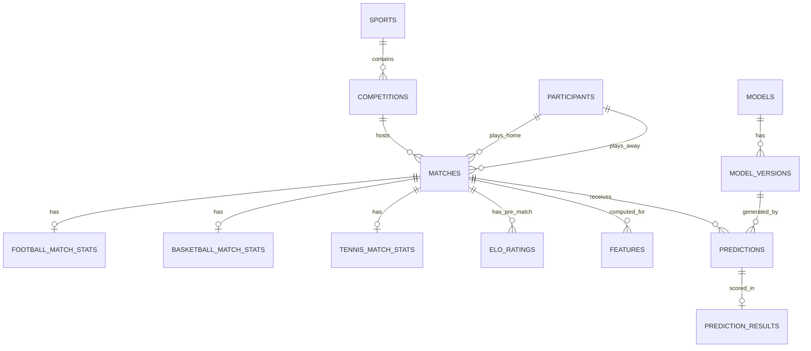

# Multi-Sport Prediction Platform: System Architecture Specification

**System**: Production-Quality Probabilistic Sports Forecasting Engine  
**Sports Supported**: Football (Soccer), Basketball (NBA), Tennis (ATP/WTA)  
**Architecture Paradigm**: Modular, Anti-Leakage, Decoupled Domain-Driven Design (DDD)  
**Database**: PostgreSQL (with SQLite compatibility layer for isolated zero-dependency unit tests)  

---

## 1. High-Level Architecture Overview

The platform is designed around a strictly unidirectional, time-aware pipeline. No layer is permitted to access data whose timestamp is equal to or greater than the match kickoff/start timestamp.

```
                           +------------------------------------------+
                           |           Data Sourcing Layer            |
                           |  (Historical CSVs, Manual Entry, APIs)   |
                           +--------------------+---------------------+
                                                |
                                                v
                           +--------------------+---------------------+
                           |   Validation & Identity Resolution       |
                           |   (Alias mapping, sanity, plausibility)  |
                           +--------------------+---------------------+
                                                |
                                                v
                           +--------------------+---------------------+
                           |      Normalized Data Store               |
                           |      PostgreSQL / Normalized Tables      |
                           +--------------------+---------------------+
                                                |
                        +-----------------------+-----------------------+
                        |                                               |
                        v                                               v
           +------------+------------+                     +------------+------------+
           | Historical Training     |                     | Online Inference        |
           | Time-Aware Feature Cut  |                     | Pre-Match Feature Engine|
           +------------+------------+                     +------------+------------+
                        |                                               |
                        v                                               v
           +------------+------------+                     +------------+------------+
           | Candidate Model Training|                     | Production Model        |
           | (Baselines, Ridge,      |                     | Registry & Inference    |
           |  RandomForest, XGBoost) |                     +------------+------------+
           +------------+------------+                                  |
                        |                                               v
                        v                                  +------------+------------+
           +------------+------------+                     | Probability Calibration |
           | Validation & Calibration|                     | (Isotonic / Platt)      |
           | (Out-of-sample fit)     |                     +------------+------------+
           +------------+------------+                                  |
                        |                                               v
                        v                                  +------------+------------+
           +------------+------------+                     | Market Translation &    |
           | Model Governance &      |                     | Explainability Engine   |
           | Promotion Gatekeeper    |                     +------------+------------+
           +-------------------------+                                  |
                                                                        v
                                                           +------------+------------+
                                                           | FastAPI Backend         |
                                                           | REST Endpoints          |
                                                           +------------+------------+
                                                                        |
                                                                        v
                                                           +------------+------------+
                                                           | React / Web Dashboard   |
                                                           +-------------------------+
```

---

## 2. Component Separation: Shared vs. Sport-Specific

### 2.1 Shared Platform Core
The following components are completely sport-agnostic and reusable across any current or future sport:
1. **Canonical Identity & Alias Resolver**: Maps raw strings into canonical UUIDs (`entity_aliases`).
2. **Time-Aware Feature Store Framework**: Enforces point-in-time cuts ($t_{feature} < t_{event}$); prevents data leakage.
3. **Model Abstraction Interface (`BaseSportModel`)**:
   - `fit(X, y)`
   - `predict_proba(X)`
   - `evaluate(X, y)`
4. **Probability Calibration Engine**:
   - Platt Sigmoid Scaling (`CalibratedClassifierCV(method='sigmoid')`)
   - Isotonic Regression (`CalibratedClassifierCV(method='isotonic')`)
   - Brier Score & Multi-class Log Loss evaluation
   - Reliability diagram / ECE (Expected Calibration Error) calculator
5. **Ensemble Engine**:
   - Equal-weighted averaging
   - Soft-voting constrained optimization (fitted strictly on validation split)
6. **Chronological Backtesting Engine**:
   - Expanding window & rolling walk-forward cross-validation.
7. **Model Registry & Governance Gatekeeper**:
   - Model versioning (`v1.0.0`, `v1.1.0`), candidate evaluation against production champions, automated rollback.
8. **Prediction Market Engine**:
   - Multi-market abstraction: transforms probability vectors into betting/statistical market outcomes (e.g., 1X2, Over/Under, Spreads).
9. **FastAPI Application & Database ORM / Migration Engine**:
   - Standard REST endpoints, schema validation via Pydantic v2, PostgreSQL connection pooling.

### 2.2 Sport-Specific Modules
Each sport implements a dedicated domain package (`src/sports/{sport}/`):

| Sport | Domain Logic (`src/sports/football/`) | Domain Logic (`src/sports/basketball/`) | Domain Logic (`src/sports/tennis/`) |
| :--- | :--- | :--- | :--- |
| **Match Context** | Home vs. Away, Neutral venue, Rest days, Congestion (matches in 7/14 days) | Home vs. Away, Back-to-back flags, Rest days, Travel/Conference | Tournament tier (Grand Slam vs 250), Surface (Hard/Clay/Grass), Best-of-3 vs Best-of-5 |
| **Rating System** | Team Elo with Home Pitch Advantage adjustment | Team Elo + Net Rating / Pace-adjusted Elo | Player Elo + Surface-Specific Elo (Clay Elo, Grass Elo, Hard Elo) |
| **Form / Rolling Engine** | Rolling 3, 5, 10 matches (Goals for/against, Shots, SOT, Corners, Cards, Points earned) | Rolling 5, 10 games (Pace, ORtg, DRtg, eFG%, TS%, Rebound %, Assist %, TOV %) | Rolling 3, 5, 10 matches (Win rate, Surface win rate, 1st serve %, 1st serve won %, BP saved/faced %) |
| **Target Variables** | 1X2, Over/Under goals (0.5 to 4.5), Both Teams to Score (BTTS), Half-Time Result | Match Winner (Moneyline), Total Points (Over/Under), Point Margins | Match Winner, Set Betting (2-0, 2-1), Total Games Over/Under |

---

## 3. Normalized Database Schema Design (PostgreSQL)

### 3.1 Entity Relationship Diagram



### 3.2 Core Table Definitions

```sql
-- 1. Sports Registry
CREATE TABLE sports (
    sport_id VARCHAR(32) PRIMARY KEY, -- 'football', 'basketball', 'tennis'
    display_name VARCHAR(64) NOT NULL,
    created_at TIMESTAMP WITH TIME ZONE DEFAULT NOW()
);

-- 2. Competitions / Leagues / Tournaments
CREATE TABLE competitions (
    competition_id VARCHAR(64) PRIMARY KEY,
    sport_id VARCHAR(32) REFERENCES sports(sport_id),
    name VARCHAR(128) NOT NULL,
    country VARCHAR(64),
    tier VARCHAR(32), -- 'TIER_1', 'GRAND_SLAM', 'MASTERS_1000', 'NBA'
    created_at TIMESTAMP WITH TIME ZONE DEFAULT NOW()
);

-- 3. Participants (Teams or Individual Players)
CREATE TABLE participants (
    participant_id VARCHAR(64) PRIMARY KEY,
    sport_id VARCHAR(32) REFERENCES sports(sport_id),
    entity_type VARCHAR(16) NOT NULL, -- 'TEAM' or 'PLAYER'
    canonical_name VARCHAR(128) NOT NULL,
    country_code VARCHAR(3),
    created_at TIMESTAMP WITH TIME ZONE DEFAULT NOW()
);

-- 4. Entity Aliases (for robust normalization and duplicate prevention)
CREATE TABLE participant_aliases (
    alias_id SERIAL PRIMARY KEY,
    participant_id VARCHAR(64) REFERENCES participants(participant_id),
    alias_name VARCHAR(128) NOT NULL UNIQUE,
    source VARCHAR(32) NOT NULL
);

-- 5. Unified Matches Table
CREATE TABLE matches (
    match_id VARCHAR(64) PRIMARY KEY,
    sport_id VARCHAR(32) REFERENCES sports(sport_id),
    competition_id VARCHAR(64) REFERENCES competitions(competition_id),
    season VARCHAR(16) NOT NULL,
    event_date TIMESTAMP WITH TIME ZONE NOT NULL,
    participant_a_id VARCHAR(64) REFERENCES participants(participant_id),
    participant_b_id VARCHAR(64) REFERENCES participants(participant_id),
    winner_id VARCHAR(64) REFERENCES participants(participant_id),
    score_a INTEGER,
    score_b INTEGER,
    status VARCHAR(24) NOT NULL, -- 'SCHEDULED', 'COMPLETED', 'POSTPONED', 'CANCELLED'
    surface VARCHAR(24),        -- For tennis: 'HARD', 'CLAY', 'GRASS'
    round VARCHAR(24),          -- 'FINAL', 'SEMI_FINAL', 'REGULAR_SEASON', etc.
    source VARCHAR(32) NOT NULL,
    source_id VARCHAR(64) NOT NULL,
    created_at TIMESTAMP WITH TIME ZONE DEFAULT NOW(),
    updated_at TIMESTAMP WITH TIME ZONE DEFAULT NOW()
);

-- 6. Pre-Match Elo Ratings Snapshots (Auditable, strictly pre-match)
CREATE TABLE elo_ratings (
    elo_id SERIAL PRIMARY KEY,
    match_id VARCHAR(64) REFERENCES matches(match_id),
    participant_id VARCHAR(64) REFERENCES participants(participant_id),
    rating_type VARCHAR(32) NOT NULL, -- 'OVERALL', 'HARD', 'CLAY', 'GRASS'
    pre_match_elo DOUBLE PRECISION NOT NULL,
    post_match_elo DOUBLE PRECISION,
    rating_timestamp TIMESTAMP WITH TIME ZONE NOT NULL
);

-- 7. Time-stamped Features (Zero-Leakage Guarantee)
CREATE TABLE match_features (
    feature_id SERIAL PRIMARY KEY,
    match_id VARCHAR(64) REFERENCES matches(match_id),
    features_version VARCHAR(32) NOT NULL,
    feature_timestamp TIMESTAMP WITH TIME ZONE NOT NULL,
    features_json JSONB NOT NULL, -- Key-value map of computed feature floats
    created_at TIMESTAMP WITH TIME ZONE DEFAULT NOW()
);

-- 8. Model Registry & Versions
CREATE TABLE models (
    model_id VARCHAR(64) PRIMARY KEY,
    sport_id VARCHAR(32) REFERENCES sports(sport_id),
    market_id VARCHAR(64) NOT NULL,
    model_name VARCHAR(128) NOT NULL,
    algorithm VARCHAR(64) NOT NULL, -- 'logistic_regression', 'random_forest', 'xgboost', 'ensemble'
    created_at TIMESTAMP WITH TIME ZONE DEFAULT NOW()
);

CREATE TABLE model_versions (
    version_id VARCHAR(64) PRIMARY KEY,
    model_id VARCHAR(64) REFERENCES models(model_id),
    version_tag VARCHAR(32) NOT NULL, -- 'v1.0.0'
    training_start_date TIMESTAMP WITH TIME ZONE NOT NULL,
    training_end_date TIMESTAMP WITH TIME ZONE NOT NULL,
    training_samples INTEGER NOT NULL,
    validation_log_loss DOUBLE PRECISION,
    validation_brier_score DOUBLE PRECISION,
    validation_accuracy DOUBLE PRECISION,
    calibration_method VARCHAR(32), -- 'isotonic', 'sigmoid', 'none'
    hyperparameters JSONB,
    artifact_path VARCHAR(256),
    is_active BOOLEAN DEFAULT FALSE,
    promoted_at TIMESTAMP WITH TIME ZONE,
    created_at TIMESTAMP WITH TIME ZONE DEFAULT NOW()
);

-- 9. Predictions Log (Persistent & Auditable)
CREATE TABLE predictions (
    prediction_id VARCHAR(64) PRIMARY KEY,
    match_id VARCHAR(64) REFERENCES matches(match_id),
    market_id VARCHAR(64) NOT NULL,
    version_id VARCHAR(64) REFERENCES model_versions(version_id),
    prediction_timestamp TIMESTAMP WITH TIME ZONE NOT NULL,
    probabilities JSONB NOT NULL,
    predicted_outcome VARCHAR(64) NOT NULL,
    data_quality VARCHAR(16) NOT NULL, -- 'HIGH', 'MEDIUM', 'LOW'
    top_features JSONB,
    created_at TIMESTAMP WITH TIME ZONE DEFAULT NOW()
);

-- 10. Prediction Outcomes & Evaluation Store
CREATE TABLE prediction_results (
    result_id SERIAL PRIMARY KEY,
    prediction_id VARCHAR(64) REFERENCES predictions(prediction_id) UNIQUE,
    actual_outcome VARCHAR(64) NOT NULL,
    is_correct BOOLEAN NOT NULL,
    log_loss DOUBLE PRECISION NOT NULL,
    brier_score DOUBLE PRECISION NOT NULL,
    evaluated_at TIMESTAMP WITH TIME ZONE DEFAULT NOW()
);
```

### 3.3 Optimized Database Indexes
To guarantee rapid chronological time-window queries:
```sql
CREATE INDEX idx_matches_sport_date ON matches(sport_id, event_date);
CREATE INDEX idx_matches_participants ON matches(participant_a_id, participant_b_id);
CREATE INDEX idx_elo_participant_date ON elo_ratings(participant_id, rating_timestamp);
CREATE INDEX idx_features_match ON match_features(match_id);
CREATE INDEX idx_predictions_match_market ON predictions(match_id, market_id);
CREATE INDEX idx_predictions_timestamp ON predictions(prediction_timestamp);
```

---

## 4. Anti-Leakage Protocol & Automated Validation

1. **Temporal Cut Rule**:
   $$\forall \text{ match } m \text{ at time } T_m, \quad \mathcal{F}(m) = f(\{ m' \in \mathcal{M} \mid T_{m'} < T_m \})$$
2. **Automated Assertion in Feature Engine**:
   Every feature computation step runs an automated assertion:
   ```python
   assert all(history_match.event_date < target_match.event_date), \
       f"CRITICAL LEAKAGE: Event {history_match.match_id} occurred at {history_match.event_date} >= target match date {target_match.event_date}"
   ```
3. **No Target Leakage**:
   The `match.score_a`, `match.score_b`, and `match.winner_id` of the target match are strictly excluded from the feature generation context.
4. **Historical Elo Isolation**:
   Pre-match Elo ratings are computed step-by-step in chronological sequence. Elo updates occur strictly *after* feature generation and outcome revelation.
